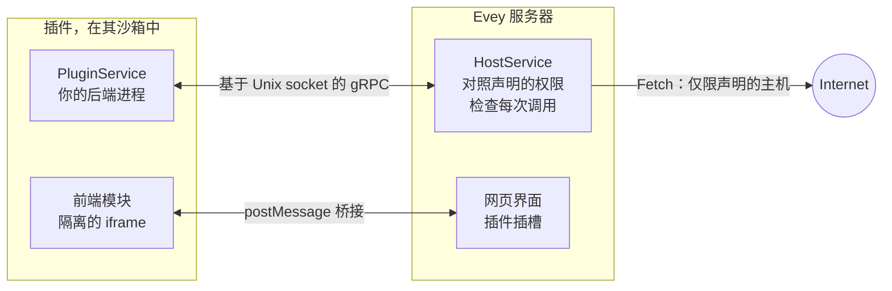

# 插件

插件为 Evey 增加它本身不具备的功能：元数据来源、通知渠道、Webhook 接收器、首页区块、播放器叠加层和主题。每个插件都是一个独立的进程，通过本地 socket 与服务器通信，由沙箱隔离，并且只拥有其清单中声明的权限。如果它有界面，界面运行在页面中的一个隔离框架里。

<figure class="evey-shot" markdown="span">
  { loading=lazy }
  <figcaption>没有插件。</figcaption>
</figure>

<figure class="evey-shot" markdown="span">
  { loading=lazy }
  <figcaption>带有示例天气插件：顶部的一个区块，在它自己的框架中绘制（界面为英文）。</figcaption>
</figure>

## 安装和管理插件

**Admin → 插件** 从 ZIP 文件安装插件。在安装任何东西之前，预览会显示：

<figure class="evey-shot" markdown="span">
  { loading=lazy }
  <figcaption><strong>Admin → 插件</strong>：可用的运行时、资源限制，以及每个插件一张卡片（界面为英文）。</figcaption>
</figure>

- 插件声明的权限、它想要出现的界面插槽，以及它将联系的主机；
- 静态分析在其代码中发现的问题；
- 当服务器检查签名时，它的签名。

分析发现严重模式的插件会被拒绝。已安装插件的更新会经过同样的预览；当更新请求新的权限、插槽或主机时，你必须明确接受这些差异。

之后每个插件的卡片上都有：启用或禁用、更新、日志，以及它的资源限制（内存、进程、磁盘、CPU 优先级）。**安全仪表板** 中的 **主机沙箱** 一行显示这台主机上实际生效的沙箱模式：如果显示 `basic`，见[插件沙箱设置](plugins/sandbox-deployment.md)。

插件默认启用。`EVEY_PLUGINS_ENABLED=false` 会完全关闭这个子系统。

## 插件能做和不能做什么

插件只能看到自己的目录，看不到服务器的数据；没有直接的网络访问（被允许联网的插件只能通过服务器访问它声明过的主机）；除非声明了 `subprocess` 权限，否则不能启动进程。插件可以请求的权限列在[权限与插槽](plugins/security-model.md)中。沙箱如何工作，以及它仍然无法阻止什么，在[安全模型与插件沙箱](SECURITY.md)中说明。

像对待任何软件一样，在安装第三方插件之前先审查它：一旦某个主机出现在插件的列表中，服务器就无法检查插件发送给它的内容。

## 编写插件

插件可以用其 `entrypoint` 能启动的任何语言编写。附带了为 Python、Node.js、PHP、Ruby、Dart、Java 和 Swift 生成的 gRPC 存根；Go 存根用 `protoc-gen-go` 生成；编译后的二进制文件需要 `native-binary` 权限。

| 页面 | 内容 |
| --- | --- |
| [编写插件](plugins/dev-setup.md) | 前提条件、第一个插件、安装循环、签名、分发。从这里开始。 |
| [插件 API 参考](plugins/api-reference.md) | 清单、后端调用和数据存储、`evey.*` 前端桥接、能力。 |
| [权限与插槽](plugins/security-model.md) | 清单可以声明什么、安装时检查什么、外部访问规则、插槽。 |
| [主题](themes.md) | 用 CSS 和一个沙箱化的脚本重新设计界面样式。 |
| [Webhook 与 API 密钥](webhooks-api-keys.md) | 不编写插件就把 Evey 与其他工具集成。 |
