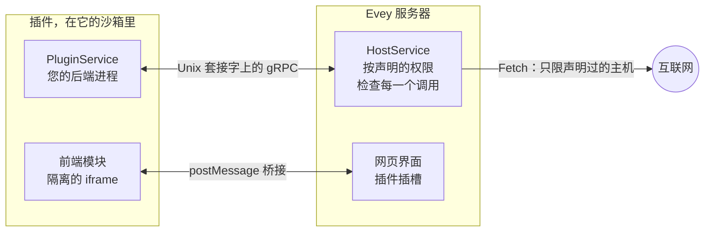

# 编写插件 { #writing-a-plugin }

本页带开发者从克隆 Evey 开始，到让一个插件在本地服务器上运行起来，再到做出一个其他管理员也能安装的签名包。
[第 3 节](#3-your-first-plugin-step-by-step)的教程介绍基本流程；其余部分是供以后查阅的参考资料。
具体的调用和字段在[插件 API 参考](api-reference.md)里。



插件是一个 ZIP 包，根目录里有一个 `plugin.yaml`，还有一个由服务器在沙箱里启动的后端进程。
这个进程在一个 Unix 套接字上提供一个简单的 gRPC 服务，再通过另一个套接字调用服务器。
插件还可以带一个界面模块，显示在页面里一个沙箱化的框架中；它与外部通信只能经过服务器，而且只能访问它声明过的主机。

## 1. 准备工作 { #1-prerequisites }

| 工具 | 用途 |
|---|---|
| Go 1.27、带 pnpm 的 Node.js 22、带 Compose 的 Docker | 开发环境（`make dev`）要用它们构建服务器和网页应用。 |
| `bubblewrap`（`bwrap`） | 只有 `bubblewrap` 和 `strict` 沙箱模式才需要。默认的 `auto` 模式使用 Landlock，在 5.13 或更新的内核上什么都不用装。 |
| [cosign](https://docs.sigstore.dev/cosign/installation/) | 在分发之前给插件包签名（[第 7 节](#7-sign-your-plugin)）。开发时用不到。 |

从服务器能启动的运行时里选择插件的语言：`python`、`nodejs`、`php`、`ruby`、`lua`、`bash` 和 `sh` 需要镜像里有对应的解释器；
`go` 提供编译好的二进制文件，需要 `native-binary` 权限。默认镜像带有 Python、Node.js、PHP、Ruby 和 Lua；`-nodejs` 镜像保留 Python 和 Node.js，`-lean` 镜像只保留 Python。
如果清单写了镜像里没有的运行时，安装时就会被拒绝，并列出可用的运行时。

gRPC 约定只有一个文件：`proto/plugin/v1/plugin_api.proto`。只有 Python SDK 附带生成好的存根；`sdk/<language>/` 下其他语言的目录里是 `.proto`。
插件启动时，服务器会把对应语言的文件复制到您的入口文件旁边。镜像为 Python 插件提供了 `grpcio`，所以 Python 插件不需要自带任何依赖。
Node.js 插件必须把自己的 `node_modules`（`@grpc/grpc-js` 和 `@grpc/proto-loader`）放进包里。
其他语言请用 `protoc` 生成存根，并放进 ZIP 包里：

```bash
protoc --proto_path=proto \
       --<lang>_out=OUT_DIR --grpc_<lang>_out=OUT_DIR \
       proto/plugin/v1/plugin_api.proto
```

`make plugin-sdk` 会重新生成随附的存根；每个 `sdk/<lang>/README.md` 都写明了该语言需要哪个 gRPC 插件。

## 2. 在本地启动 Evey { #2-bring-up-evey-locally }

```sh
git clone git@github.com:eveyproject/evey.git
cd evey
cp .env.dev.example .env.dev   # 然后设置 MEDIA_DIR、EVEY_DB_PASSWORD、MEILI_MASTER_KEY
make setup                      # 只需一次：把 evey.test 加进 /etc/hosts
make dev                        # postgres、meilisearch、服务器（Air）、网页应用（Vite）
```

打开 `https://evey.test`。第一次启动时，设置向导会创建管理员账户，见[首次设置](../getting-started/first-setup.md)。
插件文件放在 `./evey-data/plugins/<plugin-id>/`，在容器里挂载为 `/data/plugins`。

## 3. 一步步写出第一个插件 { #3-your-first-plugin-step-by-step }

示例 `examples/plugins/nodejs-example` 是最小的完整插件：它提供 `PluginService`，连接 `HostService`，
并在服务器启动它时往日志里写一行。我们把它复制一份，改一处，然后安装。

1. **复制示例。**

    ```sh
    cp -r examples/plugins/nodejs-example ~/hello-plugin
    cd ~/hello-plugin
    ```

2. **为它命名。** 编辑 `plugin.yaml`：

    ```yaml title="plugin.yaml"
    name: hello-plugin          # 唯一，kebab-case 格式
    kind: plugin
    version: 1.0.0              # semver：每次上传都要调高
    description: Says hello in its log
    author: you
    language: nodejs            # 服务器必须具备的运行时
    entrypoint: node main.js    # 服务器执行的命令行
    permissions:
      - api.library             # 允许后端读取媒体条目
    ```

    `language` 告诉服务器要检查哪个运行时、复制哪些存根；`entrypoint` 是它要执行的命令，
    在插件的目录里运行，并带有下一步介绍的环境变量。

3. **阅读 `main.js`。** 服务器给进程传三个变量：`EVEY_PLUGIN_ID`、`EVEY_PLUGIN_SOCK`（*您的*进程必须在这个套接字上监听，提供 `PluginService`）
   和 `EVEY_HOST_SOCK`（您连接这个套接字来调用 `HostService`）。示例从自己的目录加载 `plugin_api.proto`（服务器把它复制到了那里），
   并实现了 `PluginService` 的五个方法。改一下 `Initialize` 里的消息：

    ```js title="main.js（节选）"
    Initialize(call, callback) {
      hostLog("LOG_LEVEL_INFO", `hello from ${process.env.EVEY_PLUGIN_ID}`);
      callback(null, { success: true });
    },
    ```

4. **打包成 ZIP。** 清单必须位于压缩包的根目录，不能放在子目录里：

    ```sh
    zip -r ../hello-plugin.zip . -x ".*"
    ```

5. **安装它。** 在**管理 → 插件**里点**安装插件**，选择 ZIP 包，再点**预览并安装**：预览会列出 `api.library` 以及静态分析的结果。
   通过 API 进行同样的上传：

    ```sh
    curl -F "plugin=@hello-plugin.zip" \
         -H "Authorization: Bearer $EVEY_TOKEN" \
         https://evey.test/api/v1/admin/plugins/upload
    ```

6. **查看日志。** 在插件卡片上，**日志**会显示 `Initialize` 写下的那一行。`docker compose logs evey` 里有同一次启动在服务器这一侧的记录，以插件的 id 标注。

7. **反复修改。** 改代码，调高 `version`，重新打包，然后在卡片上用**从源更新…**。版本相同或更低的上传会被拒绝；
   清单里新增的权限会触发一个需要管理员批准的同意步骤。

到这里，您已经掌握了全部的后端约定。接下来，插件可以朝三个方向扩展：调用服务器（`HostService`，第 4 节）、
绘制界面（第 5 节）、与外界通信（第 6 节）。

## 4. 从后端调用服务器 { #4-call-the-server-from-the-backend }

每个 `HostService` 调用都带着插件的身份：服务器根据 PID 检查套接字另一端的进程，一个拦截器会拒绝清单没有声明所需权限的任何调用。
有三组调用完全不需要权限：

- `Log` 写入插件的日志，显示在插件卡片上；
- `GetConfig` 读取管理员在**配置**里设置的值（在 `config_schema` 里声明），`SetConfig` 让插件在那里保存自己的键；
- `GetData` / `SetData` / `DeleteData` / `ListDataKeys` 是插件私有的键值存储，卸载时清空。

`GetMediaItem` 和 `ListMediaItems` 需要 `api.library` 或 `media.read`；`Fetch` 需要 `network`。
完整的表格，包括约定里已经声明但还没有提供的方法，见
[插件 API 参考](api-reference.md#hostservice-what-the-plugin-can-call)。

## 5. 添加界面 { #5-add-an-interface }

界面是一个 JavaScript 模块，页面把它加载到一个沙箱化的框架里，放在服务器允许的某个插槽中。声明文件在哪里、模块放在哪里：

```yaml title="plugin.yaml"
web_root: dist               # 作为静态资源提供的目录
frontend:
  - slot: home.section       # 见插槽列表
    src: dist/index.js       # 必须位于 web_root 之下
```

模块会拿到一个 `window.evey` 桥接接口：`evey.onInit` 把插件的配置、语言区域、主题以及它所在的界面类型交给它；
`evey.resize`、`evey.toast` 和 `evey.navigate` 在固定的限度内操作页面；当清单声明了 `prefs` 或 `public` 时，
`evey.prefs.*` 和 `evey.media.*` 会借助宿主为框架持有的一个短期令牌访问服务器。
`examples/plugins/weather` 是一个带构建步骤的完整小组件；`examples/plugins/data-demo` 演示了 `prefs`、`public` 和 `admin.nav` 插槽。
桥接接口和插槽的说明见[插件 API 参考](api-reference.md#frontend-api)。

## 6. 与外界通信 { #6-reach-the-outside-world }

在启动器运行的每一种模式下，插件进程都不能打开通向互联网的套接字（没有启动器的 `basic` 只拒绝 `execve`）。唯一的途径是 `HostService` 的 `Fetch` 调用：
服务器按清单检查目标，然后由它自己发出请求。

```yaml title="plugin.yaml"
permissions:
  - network
external_fetch:
  - api.open-meteo.com       # 单纯的主机名：不带协议、不用通配符、不写 IP
```

声明了 `network` 却没有 `external_fetch`，安装会被拒绝。运行时，代理只接受 `http` 和 `https`、`GET` 和 `HEAD`，
在 20 秒内返回最多 8 MiB 的响应，并且拒绝私有或保留地址，经过重定向也一样。界面的框架拿到同一份主机列表作为它的 `connect-src`，
所以小组件可以通过 `https` 直接调用这些主机。规则见[权限与插槽](security-model.md#external-fetch-rules)。

!!! note "主机列表是您和管理员之间的约定"
    管理员在更新时和**安全仪表板**里会看到主机列表，更新时新增的任何主机都必须经过批准。只写插件真正需要的主机，
    并在 README 里说明每个主机会收到什么。

## 7. 给插件签名 { #7-sign-your-plugin }

!!! info "签名能证明什么"
    签名说明管理员安装的 ZIP 包，和**您**发布的那个逐字节相同。您的公钥随包一起分发（ZIP 根目录下的 `cosign.pub`），Evey 在安装时把它的指纹固定在插件上：用另一把密钥签名、或不再签名的更新会被拒绝，直到管理员接受这个变化。
    它不说明插件做了什么：权限、主机列表和预览里的分析照样适用。Evey 在进程内离线检查签名
    （对 ZIP 的 SHA-256 做 ECDSA P-256 签名，也就是 `cosign sign-blob --key` 生成的格式）：
    服务器上不需要 `cosign` 程序，不联网，也不用透明日志。

只有您自己的机器上需要 [cosign](https://docs.sigstore.dev/cosign/installation/)。

1. **只需一次：生成一对密钥。**

    ```sh
    # 请设置一个真正的口令；cosign.key 必须保密，绝不要提交到仓库
    COSIGN_PASSWORD="your-passphrase" cosign generate-key-pair
    # -> cosign.key（私钥）和 cosign.pub（您分发出去的文件）
    ```

2. **每次发布：把您的公钥放在插件根目录，再打包，再签名**，签的必须是您要分发的那个文件。

    ```sh
    cp cosign.pub hello-plugin/cosign.pub
    cd hello-plugin && zip -r ../hello-plugin.zip . && cd ..

    COSIGN_PASSWORD="your-passphrase" cosign sign-blob \
      --key cosign.key --tlog-upload=false --yes \
      --output-signature hello-plugin.zip.sig \
      hello-plugin.zip
    ```

3. **发出之前先检查**，用和服务器相同的验证方式：

    ```sh
    cosign verify-blob --key cosign.pub --signature hello-plugin.zip.sig \
      --insecure-ignore-tlog hello-plugin.zip      # -> Verified OK
    ```

4. **把两个文件一起发布**：`hello-plugin.zip`（您的公钥就在里面）和 `hello-plugin.zip.sig`，放在一起，这样通过 URL 安装时能在 `<url>.sig` 找到签名。
   把密钥的指纹（`sha256:...`，Evey 会显示在插件卡片上）写进您的 README 和发布说明，方便管理员在信任这把密钥之前对照。

在要安装插件的服务器上，管理员在**管理 → 插件**里选择 ZIP 包，并在**签名文件（.zip.sig，可选）**里选择对应的 `.zip.sig`；通过 API 上传时，签名放在 `sig` 字段里。Evey 用包里自带的密钥验证这个包，并显示下面几种结果之一：

- **由 <发布者> 签名**：这把密钥在本实例的**受信任的发布者**列表里。
- **已签名 - 未知密钥 sha256:...**：签名没问题，但这把密钥还不受信任。点一下**信任此密钥**，就能给它起个名字加进列表。
- **未签名**，或**签名无效**。

后果由策略决定：`EVEY_PLUGINS_COSIGN_POLICY=warn`（默认）只记录结论，所有安装都放行；`enforce` 只接受受信任的密钥。无论策略如何，如果更新的密钥与已安装版本不同，或者去掉了签名，就会被拒绝，直到管理员在更新对话框里勾选**发布者已更改，我接受新密钥**。`EVEY_PLUGINS_COSIGN_PUBLIC_KEY` 是可选的：它在启动时往受信任列表里加入一把密钥（标记为服务器运营者的密钥）。

常见问题：

- **对 ZIP 包的任何改动都会让签名失效**，哪怕只是把同样的文件重新打包。请给您分发的那个文件签名，每个版本都重新签一次。
- **各个版本之间请使用同一把密钥。** 对每个已经安装了您的插件的管理员来说，新密钥就是新的发布者：他们会被要求接受它。换密钥要有意为之，并在发布说明里讲清楚。
- **只接受 ECDSA P-256 密钥**，`cosign generate-key-pair` 生成的正是这种。无密钥签名和 KMS 引用不会被验证。
- ZIP 里有 `.sig` 却没有 `cosign.pub`，或者反过来，都算**未签名**。
- 密钥不对、ZIP 被篡改、缺少 `.sig`，都会被当作签名失败：在 `enforce` 下，安装或更新会被拒绝。

## 8. 安装程序依次检查什么 { #8-what-the-installer-checks-in-order }

每一步都可能拒绝这个包；管理员会看到原因，服务器日志里有详细信息。

1. **清单。** 直接从 ZIP 包里读取 `plugin.yaml`：必填字段、semver 版本号、已知的权限和能力、插槽在允许列表里、
   `external_fetch` 的条目是纯主机名、声明了 `frontend` 时有 `web_root`。声明的 `language` 必须是镜像里有的运行时。
2. **版本和权限升级。** 对于已经安装的插件，新版本必须更高；任何新增的权限、能力、插槽或主机，都会让安装停在这一步，
   直到管理员批准这些差异（上传路由上的 `accept_permission_changes=true`）。
3. **签名和哈希。** 配置了公钥时会验证签名；只有在 `enforce` 下，验证失败才会阻止安装。ZIP 包的哈希会被记录下来，
   之前预览过的更新在应用时会再核对一次。
4. **解压**到一个临时目录：最多 5,000 个条目，单个文件最大 100 MB，总共最多 500 MB，压缩比不超过 100:1，
   不允许符号链接，不允许超出压缩包范围的路径。在后面每一步都通过之前，更新绝不会改动正在运行的版本。
5. **仅限主题：** 样式表会被清理并写回；`theme.js` 如果匹配到被禁止的模式，整个包会被拒绝。
6. 对每个文本文件做**静态分析**：严重级别的发现会拒绝这个包；`deserialization` 和 `obfuscation` 警告同样会拒绝；
   `native_code`、编译好的二进制文件和内嵌的压缩包也会拒绝，除非清单声明了 `native-binary`。
7. **保存并启动。** 临时目录被换到正式位置，写入数据库记录，然后启动进程。

分析会查找什么，列在[插件沙箱与威胁模型](../SECURITY.md#static-analysis)里。分析之前会先去掉注释，所以被注释掉的行不会被报告。

## 9. 您的进程在什么条件下运行 { #9-what-your-process-runs-under }

服务器以较低的 CPU 优先级启动进程，并设置内存上限、进程和线程数量上限，以及目录大小上限；
超出这些限制的插件会被监控程序停止。默认值是 256 MiB、64 个进程和 100 MiB，管理员可以在**管理 → 插件 → 资源限制**里调整。
没有 `subprocess` 权限时，无论用什么语言，进程都不能创建子进程；线程可以正常使用。

在启动器运行的每一种模式下，沙箱都会把文件系统限制在插件自己的目录里，并切断所有网络套接字（没有启动器的 `basic` 只拒绝 `execve`）。生效的是哪种模式，取决于宿主机器，而不是插件：
[插件沙箱与威胁模型](../SECURITY.md#sandbox-modes)介绍了各种模式，[插件沙箱设置](sandbox-deployment.md)告诉管理员该选哪一种。

## 10. 分发插件 { #10-distribute-a-plugin }

没有插件目录商店：管理员在管理面板里上传插件的 ZIP 包，或者粘贴它的网址，来源是您发布它的任何地方（代码托管平台上的一个 release，您自己的网站）。

- 把 ZIP 包、它的 `.sig` 和您的 `cosign.pub` 放在一起发布（第 7 节）。
- 在 README 里写明权限和 `external_fetch` 主机：管理员在安装时会看到权限，在更新时和**安全仪表板**里会看到主机，并且必须批准；这里出现未预期的内容，是安装被拒绝的首要原因。
- 如果想让您的插件和自带的示例列在一起，请向 `examples/plugins/` 提交一个 pull request，附上源代码和 README。
  示例会经过审查，并从源代码构建；被列入并不代表项目背书，也不带项目的签名。

## 11. 故障排除 { #11-troubleshooting }

| 现象 | 原因 | 解决办法 |
|---|---|---|
| `plugin requires "nodejs" runtime which is not installed in this image` | 这个镜像版本缺少对应的解释器。 | 使用默认镜像或 `-nodejs` 镜像，或者用 Python 编写插件。 |
| `manifest: external_fetch entry "*.tmdb.org" is a wildcard - use explicit hostnames` | 安装时一律拒绝通配符，没有例外。 | 列出您需要的每一个主机名（`api.tmdb.org`、`image.tmdb.org`）。 |
| `manifest: frontend slot "admin.section" not allowed` | 这个插槽不在允许列表里。 | 从[插槽列表](api-reference.md#slots)里选一个；`admin.nav` 是管理区域里唯一的插槽。 |
| `manifest: network permission requires non-empty external_fetch` | 声明了 `network` 却没有主机。 | 加上主机，或者去掉这个权限。 |
| `plugin already installed at version 1.0.0, new version must be higher` | ZIP 包的版本和已安装的相同。 | 调高 `version`，或者先卸载。 |
| `signature does not match the plugin or the configured key` | `.sig` 是用另一个密钥生成的，或者 ZIP 包在签名之后被改过。 | 用正确的密钥给这个 ZIP 包重新签名，或者修正 `EVEY_PLUGINS_COSIGN_PUBLIC_KEY`。 |
| `plugin blocked: theme.js contains forbidden pattern` | 主题脚本扫描器匹配到了被禁止的 API。 | 主题只能调用 `evey.theme.*`：见[主题](../themes.md#what-the-scanner-refuses)。 |
| 日志最后一行是 `memory quota exceeded (... MB > ... MB)` | 插件超出内存上限，被监控程序停止。 | 降低内存用量，或者在**资源限制**里调高**最大内存（MiB）**。 |
| `bwrap: ... permission denied` | 在 Docker 里使用 `bubblewrap` 模式，被容器的 seccomp 或 AppArmor 配置阻止。 | 保持默认的 `auto` 模式。否则请看[插件沙箱设置](sandbox-deployment.md)。 |
| 界面模块没有出现 | 插件被禁用了、插槽名称拼错了，或者 `src` 不在 `web_root` 之下。 | 检查卡片的状态、插槽名称，以及浏览器网络面板里 `/api/v1/plugins/<id>/assets/...` 的请求。 |

<!-- sources
runtimes, image variants: internal/adapters/driven/pluginrunner/runtime_availability.go - runtimeBinaries, compiledLanguages ; internal/app/plugin/install.go - parseAndValidateManifest ; Dockerfile (RUNTIMES lean/nodejs/full)
stubs copied at start, NODE_PATH: internal/adapters/driven/filesystem/plugin_fs.go - CopySDKStubs ; internal/adapters/driven/pluginrunner/runner_start.go ; sdk/python/README.md ; examples/plugins/nodejs-example/package.json
dev stack: DEV.md (Quick Start) ; Makefile - setup, dev ; docker-compose.yml (evey-data/plugins:/data/plugins)
example: examples/plugins/nodejs-example/main.js, plugin.yaml
env vars: internal/adapters/driven/pluginrunner/runner_start.go (EVEY_PLUGIN_ID, EVEY_PLUGIN_SOCK, EVEY_HOST_SOCK)
upload route, fields: internal/adapters/driving/http/plugin_asset_handler.go (plugin, sig, accept_permission_changes)
host RPC permissions: internal/adapters/driving/grpcapi/plugin_interceptor.go ; peer auth: internal/adapters/driving/pluginhost/peer_creds.go
host RPCs: internal/adapters/driving/pluginhost/host_server.go - Log, GetConfig, SetConfig, GetData ; fetch.go - Fetch (GET/HEAD, maxFetchBytes, fetchTimeout)
frame connect-src: frontend/packages/client/src/plugins/hostProtocol.ts - buildConnectSrc ; internal/adapters/driving/http/plugin_frame_handler.go - pluginFramePolicy
bridge: frontend/packages/client/src/plugins/bridgeScript.ts - EveyBridge
cosign: internal/adapters/driven/pluginrunner/cosign.go - loadP256PublicKey ; internal/config/config.go - CosignPolicy validation
install order: internal/app/plugin/install.go - installLocalZip, parseAndValidateManifest, resolveExistingPlugin, verifyPluginIntegrity, extractPluginToStaging, validateStagedPlugin, checkEscalatedWarnings, swapAndPersistPlugin ; update.go - ApplyUpdate ; zip limits: docs/SECURITY.md (ZIP extraction)
resource limits: internal/config/config.go - Plugins ; internal/adapters/driven/pluginrunner/runner_resmon.go ; i18n admin.plugins.resourceLimits.*
error texts: internal/adapters/driven/pluginrunner/manifest.go ; internal/domain/plugin/model.go ; internal/app/plugin/install.go ; cosign.go ; runner_resmon.go
-->
